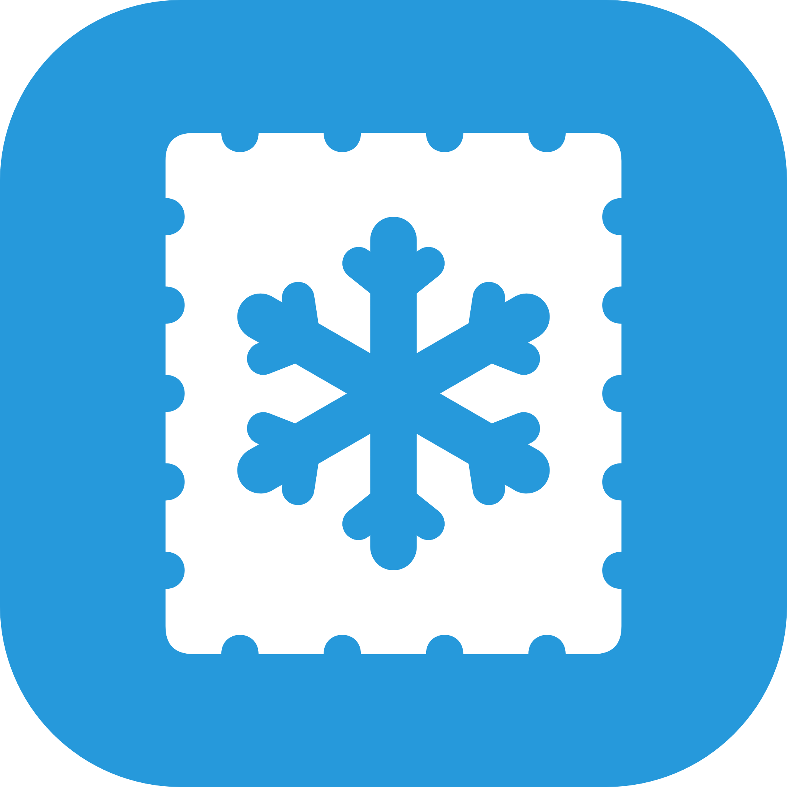

  

<h1 align="center">SnowStamp</h1>

  <em>Every resort is a stamp. Your ski and snowboard passport.</em> 
  <em>Cada estación es un sello. Tu pasaporte de esquí y snowboard.</em>

> **Status: in development. There is no app to download yet.** The project is in its pre-product phase: collecting feedback from skiers and snowboarders and laying the engineering foundations. No code has been written.

## What is SnowStamp?

SnowStamp is a mobile app to record and visualize the ski and snowboard resorts you have been to, anywhere in the world. Every resort you visit becomes a stamp in your personal passport and lights up on an interactive world map.

It is built for people who go to ski resorts, whether they ski or snowboard. The primary audience is Spanish-speaking skiers and snowboarders (Spain, Andorra, Latin America), so the app and its content are in Spanish first. The goal is a release on both the **Play Store** and the **App Store**, free to use.

## Planned features

| # | Feature | Priority |
|---|---|---|
| [#1](../../issues/1) | **Interactive world map.** Tap a country to see its resorts and mark the ones you have visited; visited resorts light up. | MVP |
| [#2](../../issues/2) | **Visited percentage.** Automatic % of resorts visited per country, per continent and worldwide. | MVP |
| [#3](../../issues/3) | **Friends.** Share your visited resorts with friends and compare. | MVP |
| [#4](../../issues/4) | **Run logging.** Per-run tracking with resort maps and timings, Strava-style. | Deferred |

Run logging is deferred on purpose: apps such as Slopes and Skitude already cover it, and it is expensive to build with little differentiation. SnowStamp focuses on the gap they leave: how much of the world you have skied, and how you compare with your friends.

## Why

Skiers already track this by hand, in spreadsheets, hand-made maps and long "resorts skied" forum threads. SnowStamp turns that into a map you can show off, with a number to go with it: "I have visited X% of the resorts in Spain".

## Give feedback

SnowStamp is shaped by the people who will use it. Before building anything, the most useful thing you can do is tell us:

- Which app or spreadsheet you use today to keep track of your resorts, and what you miss in it.
- Which of the planned features matter most to you, and what is missing.
- How many resorts you have been to and how you would like to see and share them.

**[Open the feedback form](https://forms.gle/6A3DvtVCoTi1GDPe6)** (Spanish, takes a couple of minutes). Ideas and questions are also welcome in the [issues](../../issues).

*En español: cuéntanos qué app usas hoy, qué echas en falta y qué funciones te interesan más. Tu opinión decide qué construimos.*

## Project state

- Architecture: layered and domain-centred, adopted in [ADR-001](docs/adr/001-adopt-layered-ddd-architecture.md). Full rules in [`docs/ARCHITECTURE.md`](docs/ARCHITECTURE.md).
- Technology stack: **not decided yet**, see [ADR-002](docs/adr/002-stack-selection.md) (Proposed). No code is scaffolded until it is accepted.
- Live status and next steps: [`docs/CURRENT_STATUS.md`](docs/CURRENT_STATUS.md).
- Decision log: [`docs/DECISIONS/README.md`](docs/DECISIONS/README.md).
- Brand guidelines: [`docs/BRAND.md`](docs/BRAND.md).

## Data

Resort data is planned to come from [OpenSkiMap](https://openskimap.org/) / [OpenStreetMap](https://www.openstreetmap.org/copyright) (ODbL), with visible attribution in the app. Because every percentage depends on what counts as a "resort", the list will be curated and tested before any percentage is shown.

## Contributing

The project is in an early, owner-driven phase. Rules for contributors and AI agents are in [`AGENTS.md`](AGENTS.md): Conventional Commits, atomic commits, English for all repository content.
